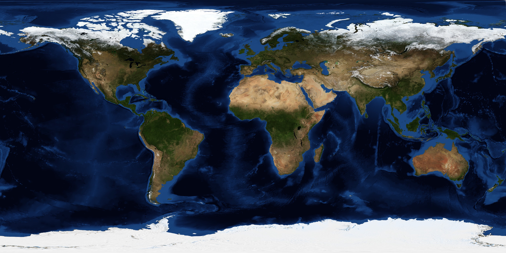
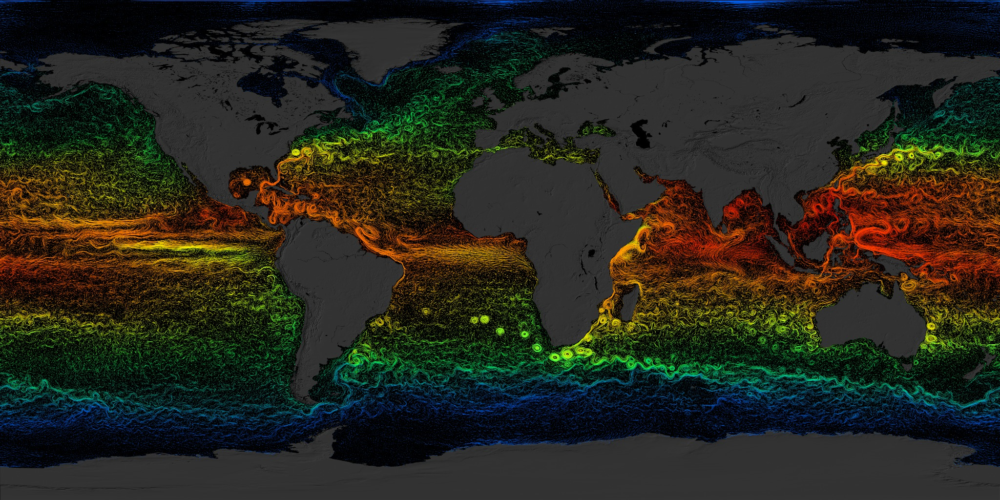
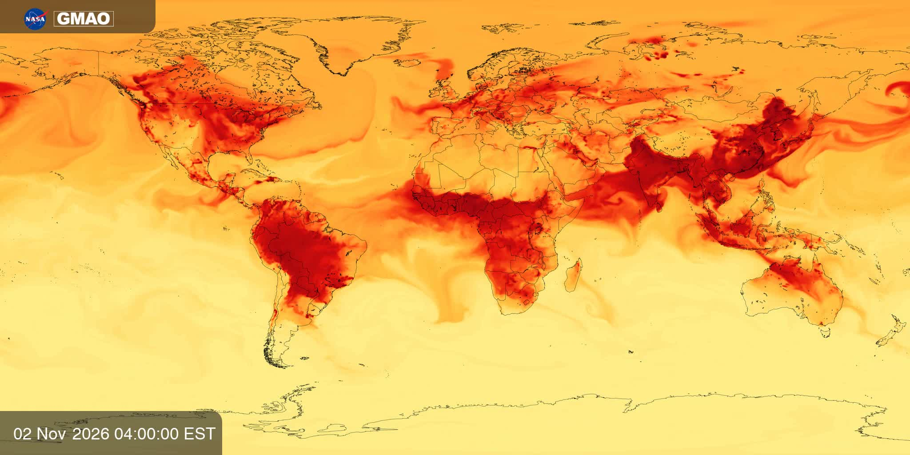
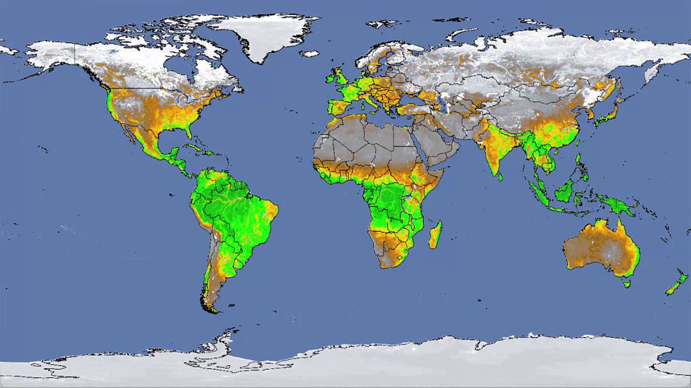
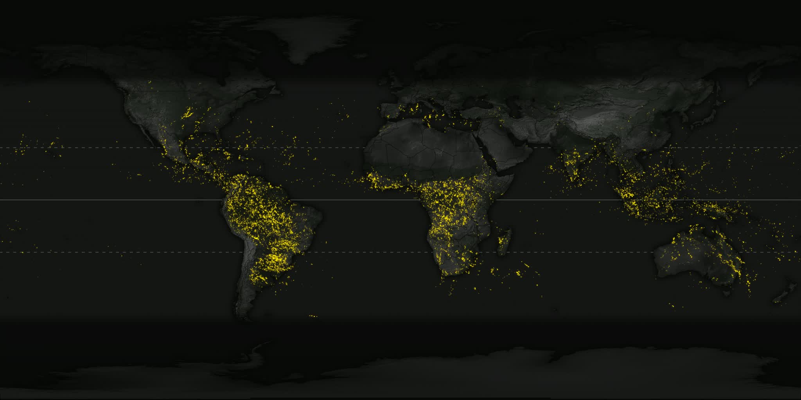
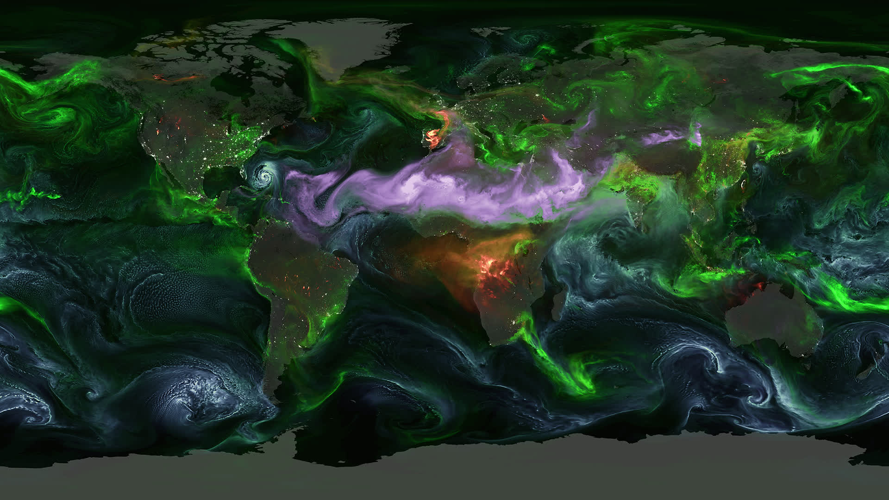

<p align="center">
	
</p>

<h1 align="center">EARTH JUKEBOX</h1>

<p align="center">
	<strong>Hear the planet change.</strong><br>
	An interactive globe that turns Earth-observation imagery into sound.
</p>

<p align="center">
	
	
	
</p>

<p align="center">
	<a href="#start-here">Start here</a> ·
	<a href="#explore-the-layers">Explore the layers</a> ·
	<a href="#api-at-a-glance">API</a>
</p>

---

## The idea

Pick a planetary data layer, focus on a region, and listen. Earth Jukebox analyzes the visual data and maps its values and changes to musical notes, rhythms, and timbres. Explore a rotating 3D globe, select a preset region or draw a custom area, then play, seek, change speed, or download the generated WAV.

## Explore the layers

The images below are the visual layers bundled with the frontend; the backend analyzes its matching source media to generate the sound.

<table>
	<tr>
		<td width="50%" align="center">
			<br>
			<strong>🌊 OCEAN TEMPERATURE</strong><br>
			Cold-to-warm color values become low-to-high notes.
		</td>
		<td width="50%" align="center">
			<br>
			<strong>🌫️ CARBON MONOXIDE</strong><br>
			Color-legend values shape pitch; rapid changes add intensity.
		</td>
	</tr>
	<tr>
		<td width="50%" align="center">
			<br>
			<strong>🌱 VEGETATION (NDVI)</strong><br>
			Bare ground sounds lower; denser vegetation sounds higher.
		</td>
		<td width="50%" align="center">
			<br>
			<strong>⚡ LIGHTNING</strong><br>
			Detected flashes become percussion; busier moments sound fuller.
		</td>
	</tr>
	<tr>
		<td width="50%" align="center">
			<br>
			<strong>🌀 AEROSOLS</strong><br>
			Black carbon, dust, sea salt, and sulfate each get a distinct instrument.
		</td>
		<td width="50%" align="center">
			<br>
			<strong>🌍 ONE GLOBE, MANY STORIES</strong><br>
			Browse the data on a 3D Earth and listen to a region that interests you.
		</td>
	</tr>
</table>

## Start here

### 1. Start the backend

From the repository root, open a terminal and run:

```bash
cd Nasa_challenge-backend
docker compose up --build
```

The API reads the bundled input files from `Nasa_challenge-backend/resources/`, mounted read-only in the container.

### 2. Start the frontend

In a second terminal, from the repository root:

```bash
cd Nasa_challenge-frontend
docker compose up --build
```

Open **[http://localhost:8080](http://localhost:8080)**. The API runs at **[http://localhost:8000](http://localhost:8000)** and its interactive docs are at **[http://localhost:8000/docs](http://localhost:8000/docs)**.

To stop a service, run `docker compose down` in that service's directory. The frontend loads `globe.gl` from `unpkg.com`, so the browser needs internet access to that CDN.

### Run the backend without Docker

The Docker image uses Python 3.11. For a local Linux setup, install FluidSynth and the General MIDI SoundFont first (Debian/Ubuntu):

```bash
sudo apt-get update
sudo apt-get install -y fluidsynth fluid-soundfont-gm
```

Then install the Python requirements and start FastAPI:

```bash
cd Nasa_challenge-backend
python -m venv .venv
source .venv/bin/activate
pip install -r requirements.txt
export MEDIA_DIR="$PWD/resources"
uvicorn server:app --host 0.0.0.0 --port 8000
```

Serve `Nasa_challenge-frontend/` with a static web server. Use an HTTP server rather than opening `index.html` as a `file://` URL, since the app fetches its catalog and media files.

## API at a glance

| Route | Purpose |
| --- | --- |
| `GET /health` | Check service health and list the supported modes. |
| `GET /files` | List media files available to the backend. |
| `GET /project?mode=ndvi` | Generate a WAV by mode; accepts optional `video`, pixel `region=x,y,w,h`, `position`, and `every_n`. |
| `POST /sound` | Generate a WAV for a geographic area. JSON body: `layer`, `lat_min`, `lat_max`, `lon_min`, `lon_max`. |

Example request (downloads the WAV response):

```bash
curl -X POST http://localhost:8000/sound \
	-H 'Content-Type: application/json' \
	-d '{"layer":"temperature","lat_min":20,"lat_max":60,"lon_min":-70,"lon_max":-10}' \
	--output earth-jukebox.wav
```

The geographic selection is mapped linearly to source-image pixels using a global longitude range of −180° to 180° and latitude range of −90° to 90° by default. This is a simple image-coordinate mapping, not a geospatial reprojection.

## How it fits together

```text
Browser: 3D globe + layer/region controls + audio player
												 │ HTTP
												 ▼
FastAPI: select media → analyze frames/pixels → create MIDI → render WAV
												 │
												 ▼
							 FluidSynth + General MIDI SoundFont
```

The frontend is static HTML/CSS/JavaScript served by Nginx. The backend uses FastAPI, OpenCV, NumPy, SciPy, PrettyMIDI, and FluidSynth. Generated WAV/MIDI files are temporary; the API returns the WAV and removes its temporary files after the response.

## Project map

| Directory / file | Role |
| --- | --- |
| `Nasa_challenge-frontend/` | Web interface, globe textures, visualization media, and frontend Docker setup. |
| `Nasa_challenge-frontend/catalog.json` | Layer names, descriptions, display images, and visualization videos. |
| `Nasa_challenge-frontend/regions.json` | Preset geographic regions. |
| `Nasa_challenge-backend/server.py` | FastAPI routes, region conversion, media lookup, and audio responses. |
| `Nasa_challenge-backend/project.py` | Image/video analysis and sonification logic. |
| `Nasa_challenge-backend/resources/` | Source media used to create each layer's sound. |

## Configuration

The backend accepts these environment variables:

| Variable | Default | What it controls |
| --- | --- | --- |
| `MEDIA_DIR` | `/data` | Directory containing backend input media. |
| `MAX_JOBS` | `2` | Number of concurrent sound-generation jobs. |
| `QUEUE_TIMEOUT` | `5` seconds | Wait for a free job slot before returning HTTP 503. |
| `CORS_ORIGINS` | `*` | Comma-separated allowed browser origins. |
| `GEO_LON_MIN`, `GEO_LON_MAX` | `-180`, `180` | Longitude range used for geographic-to-pixel mapping. |
| `GEO_LAT_MIN`, `GEO_LAT_MAX` | `-90`, `90` | Latitude range used for geographic-to-pixel mapping. |

The frontend API address is currently `http://localhost:8000`, configured in `Nasa_challenge-frontend/app.js`. For a different deployment, change that address and set `CORS_ORIGINS` on the backend to the frontend's origin.

## Requirements & troubleshooting

- Backend media defaults: `video3.webm` (vegetation), `video2.webm` (carbon monoxide), `video1.webm` (temperature), `lightning_light.mp4` (lightning), and `aerosol.jpeg` (aerosols). Keep these in `Nasa_challenge-backend/resources/`.
- Sound rendering needs the FluidSynth executable and `/usr/share/sounds/sf2/FluidR3_GM.sf2`. The backend Dockerfile installs both FluidSynth and the General MIDI SoundFont.
- `422` means the request, selected area, or media could not be processed; `503` means all generation slots remained busy past the queue timeout; `500` indicates an unexpected server-side error.
- If the page loads but sound generation fails, confirm that the backend is healthy at [http://localhost:8000/health](http://localhost:8000/health) and that the required media files are present.
